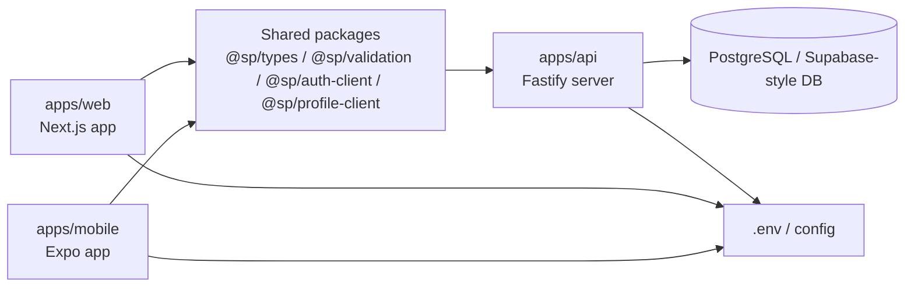

# Architecture

This document gives a simple map of how the monorepo fits together.

## High-level architecture



## Runtime flow
1. The web app and mobile app both rely on shared packages for client logic and validation.
2. They call the API for user actions, profile data, discovery, messaging, and social features.
3. The API layer reads environment config and talks to PostgreSQL.
4. Docs and SQL migration files describe the database/security model and project decisions.

## Monorepo layout
```text
Social-app/
├── apps/
│   ├── api/          # backend API
│   ├── web/          # Next.js web client
│   └── mobile/       # Expo mobile client
├── packages/
│   ├── auth-client/  # auth helpers
│   ├── profile-client/# profile helpers
│   ├── config/       # config helpers
│   ├── types/        # shared TS types
│   └── validation/   # shared validation
├── docs/             # product and project documentation
├── scripts/          # smoke automation scripts
├── .github/          # automation / CI
├── package.json      # workspace root config
├── pnpm-workspace.yaml
├── .env.example
├── README.md
└── tsconfig.base.json
```

## Product domains in this repo
The app naming strongly suggests these core domain areas:
- auth
- profile
- messaging
- community
- connections
- discovery
- safety / moderation
- sharing / reposting

## Key entry points
- Web app: `apps/web/app/page.tsx`
- Mobile app: `apps/mobile/App.tsx`
- API server: `apps/api/src/server.ts`
- Migration runner: `apps/api/src/migrate-cli.ts`
- Shared config: `packages/config/src/...`
- Shared types: `packages/types/src/...`
- Shared validation: `packages/validation/src/...`

## Useful commands
```bash
pnpm install
pnpm verify
pnpm --filter @sp/api dev
pnpm --filter @sp/web dev
pnpm --filter @sp/mobile start
```
